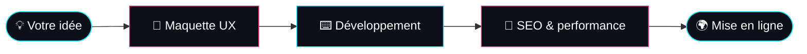

<div align="center">


[](https://hytris.net)
[](https://euroshima.github.io)
[](https://github.com/Euroshima)

<sub>`SITES SUR MESURE` ✦ `UX DESIGN` ✦ `DÉVELOPPEMENT` ✦ `SEO` ✦ `PERFORMANCE` ✦ `E-COMMERCE` ✦ `APPLICATIONS WEB`</sub>

</div>

<br>

```text
┌──────────────────────────────────────────────────────────┐
│  kevin@montreal:~$ cat profile.txt                       │
│                                                          │
│  nom       Kevin (Euroshima)                             │
│  rôle      Développeur full-stack & homelab              │
│  agence    Hytris  →  https://hytris.net                 │
│  ville     Montréal, QC                                  │
│  statut    ● disponible pour de nouveaux projets         │
└──────────────────────────────────────────────────────────┘
```

<br>

## 🏢 Hytris, mon agence web

> **[Hytris](https://hytris.net)** crée des **sites internet sur mesure** pour les entreprises, les particuliers, les mairies, les associations, les collectivités et les indépendants.

<table>
<tr>
<td width="25%" valign="top">

### 🎯 Sur mesure
Conçu pour votre activité, sans modèle générique.

</td>
<td width="25%" valign="top">

### 🎨 UX design
Des interfaces claires, pensées pour vos visiteurs.

</td>
<td width="25%" valign="top">

### 🚀 SEO & perf
Visibilité sur Google et chargement rapide.

</td>
<td width="25%" valign="top">

### 🛒 E-commerce
Boutiques en ligne et applications web.

</td>
</tr>
</table>



<div align="center">

### [👉 Découvrir hytris.net](https://hytris.net)

</div>

<br>

## ⚡ Stack

<div align="center">

**Langages**<br>


**Web / Front**<br>


**Backend / DevOps**<br>


</div>

<br>

## 🧪 Homelab & objets connectés

Je fais tourner mes propres services chez moi et je bricole des microcontrôleurs **ESP32** en C++. C'est mon terrain d'essai avant de livrer en production.

<br>

## 📬 Parlons de votre projet

<div align="center">

[](https://hytris.net)


</div>
