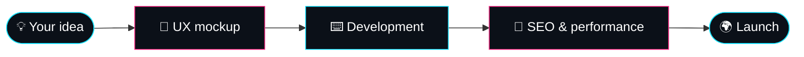

<div align="center">


[](https://hytris.net)
[](https://euroshima.github.io)
[](https://github.com/Euroshima)

<sub>`CUSTOM WEBSITES` ✦ `UX DESIGN` ✦ `DEVELOPMENT` ✦ `SEO` ✦ `PERFORMANCE` ✦ `E-COMMERCE` ✦ `WEB APPS`</sub>

</div>

<br>

```text
┌──────────────────────────────────────────────────────────┐
│  kevin@montreal:~$ cat profile.txt                       │
│                                                          │
│  name      Kevin (Euroshima)                             │
│  role      Full-stack developer                          │
│  agency    Hytris  →  https://hytris.net                 │
│  city      Montreal, QC                                  │
│  status    ● available for new projects                  │
└──────────────────────────────────────────────────────────┘
```

<br>

## 🏢 Hytris, my web agency

> **[Hytris](https://hytris.net)** builds **custom websites** for businesses, individuals, town halls, associations, local authorities and freelancers.

<table>
<tr>
<td width="25%" valign="top">

### 🎯 Custom-built
Designed around your business, never a generic template.

</td>
<td width="25%" valign="top">

### 🎨 UX design
Clear interfaces made for your visitors.

</td>
<td width="25%" valign="top">

### 🚀 SEO & speed
Visibility on Google and fast loading.

</td>
<td width="25%" valign="top">

### 🛒 E-commerce
Online stores and web applications.

</td>
</tr>
</table>



<div align="center">

### [👉 Discover hytris.net](https://hytris.net)

</div>

<br>

## ⚡ Stack

<div align="center">

**Languages**<br>


**Web / Front**<br>


**Backend / DevOps**<br>


</div>

<br>

## 📬 Let's talk about your project

<div align="center">

[](https://hytris.net)


</div>
